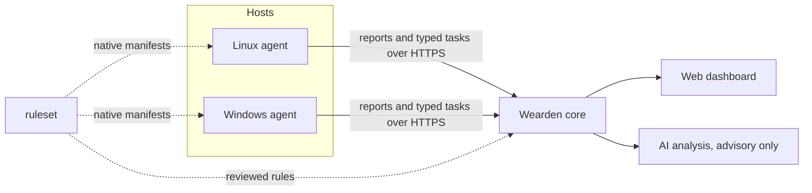

# Wearden

**Agent-based security hardening: scan, review, apply, roll back.**

Wearden checks Linux and Windows hosts against reviewed benchmarks, shows every finding in one place, and applies typed, reversible hardening changes only when an operator confirms them.

[Pitch deck](https://wearden.github.io/presentation/) · [Core](https://github.com/Wearden/core) · [Contact](mailto:contact@wearden.io)

---

## What it does

| | |
| --- | --- |
| **Scan** | Native Go agents inspect the host locally and report pass, fail or error for every control. Unsupported checks are reported as errors, never as passes. |
| **Review** | Findings, scores, ATT&CK mapping and drift appear in a web dashboard. An optional AI analysis explains and prioritises failures; it is advisory only. |
| **Apply** | A reviewed plan is queued to the agents. Each change is a typed action with a known control ID, never a downloaded script. |
| **Roll back** | Every applied change keeps a private local backup, so it can be undone from the dashboard. |

## How the pieces fit

## Repositories

| Repository | Purpose |
| --- | --- |
| [**core**](https://github.com/Wearden/core) | Go API, PostgreSQL storage, React web dashboard (English and Azerbaijani) and AI-assisted report analysis |
| [**agent-linux**](https://github.com/Wearden/agent-linux) | Linux agent for Ubuntu 22.04 and 24.04 |
| [**agent-windows**](https://github.com/Wearden/agent-windows) | Windows agent for Windows 10, Windows 11 and Server 2022 |
| [**proto**](https://github.com/Wearden/proto) | JSON Schema and Go wire contracts shared by core and the agents |
| [**ruleset**](https://github.com/Wearden/ruleset) | Benchmark content and native manifests used by the agents |
| [**presentation**](https://github.com/Wearden/presentation) | The Wearden pitch deck ([live](https://wearden.github.io/presentation/)) |

## Supported hosts

| Host | Versions | Native controls |
| --- | --- | --- |
| Ubuntu | 22.04 LTS, 24.04 LTS | 112 and 100 |
| Windows | 10, 11, Server 2022 | 100 each |

Benchmark content is a draft, CIS-inspired ruleset. It is **not** a certified CIS assessment.

## Safe by design

- **Read-only by default.** Agents only scan until remediation is enabled locally on the host.
- **No shell, no downloaded code.** Agents never launch PowerShell or a shell and never execute command strings from the ruleset or from core.
- **Confirmed and reversible.** A change needs an operator's confirmation, a task from core and a private backup that allows rollback.
- **Authenticated and encrypted.** Agents use scoped, expiring enrollment tokens and HTTPS; stored credentials and API keys are encrypted with a vault key.
- **AI stays advisory.** Only aggregated control facts are sent to a model, never host names, evidence values or credentials, and nothing is applied automatically. A local model (for example Ollama) can be used so nothing leaves your network.

## Status

Wearden is under active development; the current release is **v0.1.0-rc1**. See each repository's README for build and install instructions, starting with [core](https://github.com/Wearden/core#readme).

---

Made in Azerbaijan · [contact@wearden.io](mailto:contact@wearden.io)

